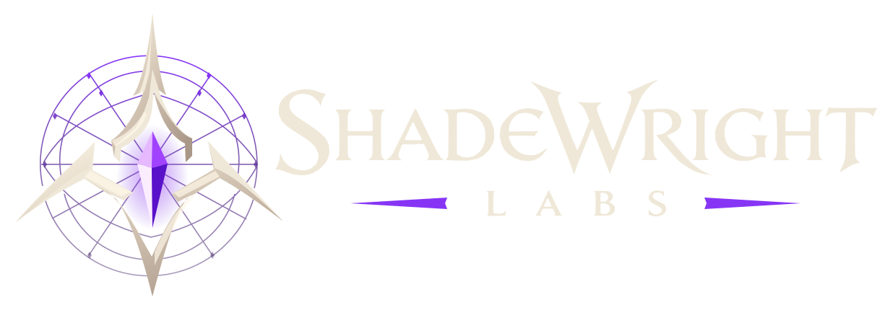
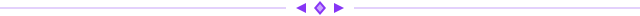

  <picture>
    <source media="(prefers-color-scheme: dark)" srcset="assets/labs-dark.svg">
    <source media="(prefers-color-scheme: light)" srcset="assets/labs-light.svg">
    
  </picture>

<em>Crafted in Shadow. Engineered with Purpose.</em>

  <a href="https://shadewright.io/">Docs</a> ·
  <a href="https://github.com/shadewright-labs/shadewright">Shadewright</a> ·
  <a href="https://github.com/shadewright-labs/shadewright/releases">Releases</a> ·
  <a href="https://github.com/shadewright-labs/shadewright/blob/main/SECURITY.md">Security</a>

Shadewright Labs is an independent software house. We build tools that let automation work on real systems inside limits a person can read and check: a typed change, a pull request, a verified result.

A *wright* is a maker, as in shipwright or wheelwright. Ours work in the half-light while operators sleep, and they sign what they make.

## The workshop

<table>
  <tr>
    <td width="260" align="center">
      <a href="https://github.com/shadewright-labs/shadewright">
        <picture>
          <source media="(prefers-color-scheme: dark)" srcset="assets/shadewright-dark.png">
          <source media="(prefers-color-scheme: light)" srcset="assets/shadewright-light.png">
          
        </picture>
      </a>
    </td>
    <td>
      <strong>Shadewright, the Guardian</strong> 
      <em>Find the fault. Put the fix up for review.</em>  
      A safe-remediation controller for Kubernetes clusters run with GitOps. It investigates an incident, turns an untrusted proposal into a typed and bounded change, delivers it only as a pull request, and verifies the result after the merge.  
      <a href="https://github.com/shadewright-labs/shadewright">Code</a> ·
      <a href="https://shadewright.io/">Docs</a> ·
      <a href="https://github.com/shadewright-labs/shadewright-azure">Reference lab</a> ·
      <a href="https://github.com/shadewright-labs/shadewright-fleet">Lab scenarios</a>
    </td>
  </tr>
  <tr>
    <td width="260" align="center">
      <picture>
        <source media="(prefers-color-scheme: dark)" srcset="assets/sablecourt-dark.png">
        <source media="(prefers-color-scheme: light)" srcset="assets/sablecourt-light.png">
        
      </picture>
    </td>
    <td>
      <strong>Sablecourt, the Court</strong> 
      <em>Many agents. One set of rules.</em>  
      A council of coding agents under shared rules. Not available yet.
    </td>
  </tr>
</table>

## On the bench

| Repository | What it is |
| --- | --- |
| [shadewright](https://github.com/shadewright-labs/shadewright) | The operator, its Helm chart and the `kubectl shadewright` plugin |
| [shadewright-azure](https://github.com/shadewright-labs/shadewright-azure) | Terraform for a disposable reference lab on AKS |
| [shadewright-fleet](https://github.com/shadewright-labs/shadewright-fleet) | The lab's Flux repo: the agent install, demo workloads and incident scenarios |
| [armory](https://github.com/shadewright-labs/armory) | Shared Go building blocks: redaction, hygiene checks, tamper-evident audit chains |

## How we build

- Untrusted input stays untrusted. A model proposes; code decides.
- A change reaches a cluster only through a pull request a person can review.
- Every release is signed and attested, and the docs say how to verify it.
- Decisions are written down as ADRs before the code.

  Found a vulnerability? Use "Report a vulnerability" on the Security tab of the repository it concerns. 
  Want to contribute? Start with <a href="https://github.com/shadewright-labs/shadewright/blob/main/CONTRIBUTING.md">CONTRIBUTING.md</a>.

