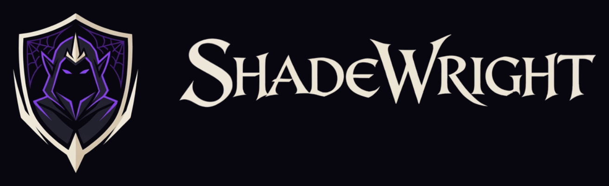

  <picture>
    <source media="(prefers-color-scheme: dark)" srcset="assets/labs-dark.svg">
    <source media="(prefers-color-scheme: light)" srcset="assets/labs-light.svg">
    
  </picture>

<em>Crafted in Shadow. Engineered with Purpose.</em>

  <a href="https://shadewrightlabs.com/">Site</a> ·
  <a href="https://github.com/shadewright-labs/shadewright">Shadewright</a> ·
  <a href="https://github.com/shadewright-labs/sablecourt">Sablecourt</a> ·
  <a href="https://shadewright.io/">Shadewright docs</a> ·
  <a href="https://github.com/shadewright-labs/shadewright/releases">Releases</a>

Shadewright Labs is an independent software house. We build tools that let automation work on real systems inside limits a person can read and check: a typed change, a pull request, a verified result.

In the house's lore, dark-elven wrights signed their work with the seal of the Arcane Forge: four ivory points around a violet crystal, and behind it a web that traces the parts holding a piece together. A *wright* is a maker, as in shipwright or wheelwright. The seal is the maker's signature on all three products.

## The workshop

<table>
  <tr>
    <td width="260" align="center">
      <a href="https://github.com/shadewright-labs/shadewright">
        <picture>
          <source media="(prefers-color-scheme: dark)" srcset="assets/shadewright-dark.png">
          <source media="(prefers-color-scheme: light)" srcset="assets/shadewright-light.png">
          
        </picture>
      </a>
    </td>
    <td>
      <strong>Shadewright, the Guardian</strong> · early releases 
      <em>Find the fault. Put the fix up for review.</em>  
      <em>The Guardian is one hooded wright of the house, at work in the half-light while others sleep. It watches from the edge, lays no hand on what it guards and keeps quiet until it finds the fault. Then it shapes a fix at its bench and hands it over, and others judge whether the work is fit to use.</em>  
      A Kubernetes operator for clusters run with GitOps. It watches events and object status in the namespaces you choose and groups them into incidents, proposes a typed change from a closed catalog of actions that deterministic policy checks, and opens a pull request in your GitOps repository with the evidence and a rollback plan. It never changes your workloads itself.  
      <a href="https://github.com/shadewright-labs/shadewright">Code</a> ·
      <a href="https://shadewright.io/">Docs</a> ·
      <a href="https://github.com/shadewright-labs/shadewright/blob/main/SECURITY.md">Security policy</a> ·
      <a href="https://github.com/shadewright-labs/shadewright-azure">Reference lab</a> ·
      <a href="https://github.com/shadewright-labs/shadewright-fleet">Lab scenarios</a>
    </td>
  </tr>
  <tr>
    <td width="260" align="center">
      <a href="https://github.com/shadewright-labs/sablecourt">
        <picture>
          <source media="(prefers-color-scheme: dark)" srcset="assets/sablecourt-dark.png">
          <source media="(prefers-color-scheme: light)" srcset="assets/sablecourt-light.png">
          
        </picture>
      </a>
    </td>
    <td>
      <strong>Sablecourt, the Court</strong> · nothing released yet 
      <em>Many agents. One set of rules.</em>  
      <em>The Court is three hooded councilors under a sable banner, and every agent or program that comes before them. Each keeps to its own seat and may only ask. The councilors answer from one written law: what it allows goes ahead, what it does not name is refused, and the gravest matters wait for a person's seal.</em>  
      Runs many coding agents, sandboxes and deterministic controllers under one set of rules, declared in manifests. A model gate with cost accounting sits in front of the model providers, and a policy that says allow, approve or deny sits in front of tools and typed actions. An approval is pinned to the SHA-256 digest of what it covers. The source is public; there is no release yet, and its open security work is tracked in the repository.  
      <a href="https://github.com/shadewright-labs/sablecourt">Code</a> ·
      <a href="https://github.com/shadewright-labs/sablecourt/tree/main/docs">Docs</a> ·
      <a href="https://github.com/shadewright-labs/sablecourt/blob/main/SECURITY.md">Security policy</a>
    </td>
  </tr>
  <tr>
    <td width="260" align="center">
      
    </td>
    <td>
      <strong>Nightloom, the Watcher</strong> · not released 
      <em>See what's running. Know what needs you.</em>  
      <em>The Watcher sits at the loom of the house, under the eclipse. Each running session is a thread across the frame, from every terminal and every machine. The Watcher weaves none of them: it follows them all, sees which has stopped or gone quiet, and knows the one that is waiting for your hand.</em>  
      One view of the coding sessions running across terminals and machines, and of the decisions waiting for the operator. Nightloom is not public yet: there is no repository or download to link to.  
      <a href="https://shadewrightlabs.com/">More on the site</a>
    </td>
  </tr>
</table>

## On the bench

| Repository | What it is |
| --- | --- |
| [shadewright](https://github.com/shadewright-labs/shadewright) | The operator, its Helm chart and the `kubectl shadewright` plugin |
| [shadewright-azure](https://github.com/shadewright-labs/shadewright-azure) | Terraform for a disposable reference lab on AKS |
| [shadewright-fleet](https://github.com/shadewright-labs/shadewright-fleet) | The lab's Flux repo: the agent install, demo workloads and incident scenarios |
| [sablecourt](https://github.com/shadewright-labs/sablecourt) | The daemon `sablecourtd`, the `sablectl` command line and the agent runtime (pre-release) |
| [shadewright-labs.github.io](https://github.com/shadewright-labs/shadewright-labs.github.io) | The site at [shadewrightlabs.com](https://shadewrightlabs.com/) |
| [armory](https://github.com/shadewright-labs/armory) | Shared Go building blocks: redaction, hygiene checks, tamper-evident audit chains |

## Six shared security laws

Every product follows the same six laws. They are rules, not a claim that every product keeps each one today: each product's security page says where it stands ([Shadewright's threat model](https://shadewright.io/threat-model/), [Sablecourt's security policy](https://github.com/shadewright-labs/sablecourt/blob/main/SECURITY.md)).

1. **Model output is never authorization.** A model or an agent can only propose. Deterministic code or a person decides what runs.
2. **Evidence over inference.** A status rests on timestamped observations of the system and says when they were made.
3. **Zero raw credentials in untrusted contexts.** A credential stays with the component it was issued to; model-directed work gets a short-lived lease scoped to one task.
4. **Bounded redaction at every disclosure boundary.** Outside text is redacted for known secret forms, in bounded time, before it reaches a model, storage, logs or a person.
5. **Out-of-band confirmation for high-impact actions.** A browser click is not proof of intent, so a person confirms on a channel that a local program cannot drive.
6. **Tamper-evident audit and separated authority.** Every decision leaves an audit record the executor cannot rewrite undetected, and no identity approves its own work.

## How we build

- A change reaches a cluster only through a pull request a person can review.
- Every Shadewright release is signed and attested, and the docs say how to verify it.
- Decisions are written down as ADRs before the code.

  Found a vulnerability? Use "Report a vulnerability" on the Security tab of the repository it concerns. 
  Want to contribute? Start with <a href="https://github.com/shadewright-labs/shadewright/blob/main/CONTRIBUTING.md">CONTRIBUTING.md</a>.

